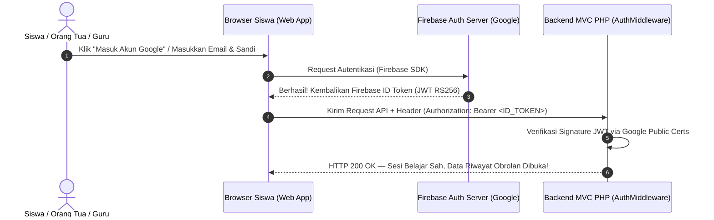

# Tutorial Lengkap Setup Firebase Authentication — Ardena AI Scratch 3

Panduan langkah-demi-langkah dari awal sampai akhir untuk menyiapkan **Firebase Authentication** (Email & Password, Google Sign-In, serta opsi Facebook) khusus untuk ekosistem **Ardena AI Scratch 3**.

---

## Daftar Isi

1. [Gambaran Arsitektur Autentikasi](#1-gambaran-arsitektur-autentikasi)
2. [Langkah 1: Membuat Project Firebase Baru](#langkah-1-membuat-project-firebase-baru)
3. [Langkah 2: Mengaktifkan Metode Login di Firebase Console](#langkah-2-mengaktifkan-metode-login-di-firebase-console)
   - [A. Mengaktifkan Email & Kata Sandi](#a-mengaktifkan-email--kata-sandi)
   - [B. Mengaktifkan Google Sign-In (Akun Belajar / Sekolah)](#b-mengaktifkan-google-sign-in-akun-belajar--sekolah)
   - [C. (Opsional) Mengaktifkan Facebook Login](#c-opsional-mengaktifkan-facebook-login)
4. [Langkah 3: Mendaftarkan Web App & Mengambil `firebaseConfig`](#langkah-3-mendaftarkan-web-app--mengambil-firebaseconfig)
5. [Langkah 4: Menambahkan Authorized Domain (Penting untuk Laragon)](#langkah-4-menambahkan-authorized-domain-penting-untuk-laragon)
6. [Langkah 5: Penerapan Kredensial pada Proyek Ardena AI](#langkah-5-penerapan-kredensial-pada-proyek-ardena-ai)
   - [A. Di Sisi Frontend (Client Web)](#a-di-sisi-frontend-client-web)
   - [B. Di Sisi Backend (`backend/.env`)](#b-di-sisi-backend-backendenv)
7. [Langkah 6: Pengujian Alur Masuk & Daftar Siswa](#langkah-6-pengujian-alur-masuk--daftar-siswa)
8. [Panduan Pemecahan Masalah (Troubleshooting)](#panduan-pemecahan-masalah-troubleshooting)

---

## 1. Gambaran Arsitektur Autentikasi

Ardena AI menggunakan pendekatan **Client-Driven Authentication with Server-Side Cryptographic Token Verification**:



**Keuntungan Model Ini:**

- Keamanan setara Google Enterprise tanpa perlu menyimpan plain text password di server lokal.
- Backend PHP Ardena AI (`AuthMiddleware.php`) memvalidasi token secara kriptografis menggunakan sertifikat publik Google (`x509`).
- Otomatis kompatibel dengan Google SSO, Email/Password, maupun penyedia OAuth lainnya.

---

## Langkah 1: Membuat Project Firebase Baru

1. Buka browser dan kunjungi: **[https://console.firebase.google.com/](https://console.firebase.google.com/)**.
2. Masuk menggunakan akun Google Anda.
3. Klik tombol **"Add project"** (atau **"Tambahkan project"**).
4. Masukkan nama project, misalnya:
   ```text
   ardenaai
   ```

   *(atau nama lain sesuai pilihan Anda)*.
5. Klik **Continue**.
6. Pada langkah *Google Analytics for your Firebase project*:
   - Anda dapat memilih untuk menonaktifkan toggle Analytics jika ingin proses setup lebih ringkas, atau biarkan aktif jika ingin statistik pengunjung.
7. Klik **Create project** (atau **Buat project**) dan tunggu 10–20 detik hingga proses provisi selesai.
8. Klik **Continue** saat project sudah siap. Anda akan diarahkan ke Dashboard Console.

---

## Langkah 2: Mengaktifkan Metode Login di Firebase Console

1. Pada menu navigasi sebelah kiri, klik **Build** $\rightarrow$ lalu pilih **Authentication**.
2. Jika ini pertama kali, klik tombol **Get started** (Mulai).
3. Anda akan otomatis masuk ke tab **Sign-in method**.

### A. Mengaktifkan Email & Kata Sandi

1. Pada daftar *Sign-in providers*, klik baris **Email/Password**.
2. Aktifkan toggle pertama: **Enable** (Aktifkan).
3. Toggle kedua (*Email link / passwordless sign-in*) biarkan tetap **NONAKTIF**.
4. Klik tombol **Save** (Simpan).

### B. Mengaktifkan Google Sign-In (Akun Belajar / Sekolah)

1. Klik tombol **Add new provider** $\rightarrow$ pilih **Google**.
2. Aktifkan toggle **Enable** (Aktifkan).
3. Isi kolom yang diminta:
   - **Project public-facing name:** Masukkan `Ardena AI Scratch 3` (nama ini akan muncul di jendela login Google siswa/orang tua).
   - **Project support email:** Pilih alamat email Google Anda dari menu dropdown.
4. Klik tombol **Save** (Simpan).

### C. (Opsional) Mengaktifkan Facebook Login

> [!NOTE]
> **Catatan Regulasi Edukasi Anak:** Pengguna utama Ardena AI adalah siswa SD (usia 6–12 tahun). Ketentuan layanan Meta (Facebook) mewajibkan pengguna berusia minimal 13 tahun. Opsi ini opsional dan ditujukan bagi orang tua/wali murid.

Jika ingin mengaktifkan Facebook Login:

1. Kunjungi portal developer Meta: **[https://developers.facebook.com/](https://developers.facebook.com/)**.
2. Buat App baru dengan tipe *Consumer* atau *Business*.
3. Dapatkan **App ID** dan **App Secret** dari menu *Settings $\rightarrow$ Basic*.
4. Kembali ke Firebase Console $\rightarrow$ Authentication $\rightarrow$ Sign-in method $\rightarrow$ **Add new provider** $\rightarrow$ pilih **Facebook**.
5. Masukkan **App ID** dan **App Secret** dari Meta ke kolom Firebase.
6. Salin **OAuth redirect URI** yang diberikan oleh Firebase, lalu tempelkan ke pengaturan *Facebook Login Settings* di Meta Developer.
7. Klik **Save**.

---

## Langkah 3: Mendaftarkan Web App & Mengambil `firebaseConfig`

Agar antarmuka web Ardena AI dapat berkomunikasi dengan Firebase Authentication, kita perlu mendaftarkan aplikasi web ke project:

1. Di Firebase Console, klik ikon **Roda Gigi (Project Settings)** di samping menu *Project Overview* pada pojok kiri atas.
2. Di tab **General**, gulir ke bawah hingga bagian **Your apps** (Aplikasi Anda).
3. Klik ikon **Web** bertanda **`</>`**.
4. Masukkan nama aplikasi pada **App nickname**, misalnya:
   ```text
   Ardena Web Client
   ```
5. Kotak centang *Also set up Firebase Hosting* **TIDAK PERLU dicentang** (karena kita menggunakan server Apache/PHP lokal Laragon).
6. Klik **Register app**.
7. Firebase akan menampilkan blok script konfigurasi JavaScript SDK. Cari bagian objek `firebaseConfig` yang memiliki bentuk seperti ini:

```javascript
// Konfigurasi Firebase Web Client Anda
const firebaseConfig = {
  apiKey: "AIzaSyBxxxxxxxxxxxxxxxxxxxxxxxxxxxxxxx",
  authDomain: "ardenaai-scratch3.firebaseapp.com",
  projectId: "ardenaai-scratch3",
  storageBucket: "ardenaai-scratch3.firebasestorage.app",
  messagingSenderId: "123456789012",
  appId: "1:123456789012:web:abcdef1234567890abcdef"
};
```

8. **Salin atau simpan objek konfigurasi ini.** Nilai-nilai ini yang akan kita gunakan pada langkah 5.

---

## Langkah 4: Menambahkan Authorized Domain (Penting untuk Laragon)

Secara default, Firebase hanya mengizinkan proses login Google OAuth dari domain `localhost` dan domain bawaan Firebase. Karena Anda menjalankan proyek ini di Laragon dengan domain virtual host **`http://ardenaai.test/`**, domain tersebut **wajib** didaftarkan agar Google Sign-In tidak memunculkan pesan error `auth/unauthorized-domain`.

1. Di Firebase Console, masuk kembali ke menu **Authentication**.
2. Klik tab **Settings** (di sebelah tab *Users* dan *Sign-in method*).
3. Pada submenu sebelah kiri, klik **Authorized domains**.
4. Klik tombol **Add domain**.
5. Masukkan nama domain lokal Anda:
   ```text
   ardenaai.test
   ```
6. Klik **Add**.
7. Pastikan juga domain `localhost` sudah ada di dalam daftar tersebut.

---

## Langkah 5: Penerapan Kredensial pada Proyek Ardena AI

### A. Di Sisi Frontend (Client Web)

Konfigurasi Firebase Web SDK akan diletakkan pada modul frontend (misalnya di `backend/public/js/firebase-config.js` atau diinjeksi via View MVC `backend/views/login.php` dan `daftar.php`):

```javascript
// Inisialisasi Firebase App
import { initializeApp } from "https://www.gstatic.com/firebasejs/10.8.0/firebase-app.js";
import { 
  getAuth, 
  signInWithEmailAndPassword, 
  createUserWithEmailAndPassword, 
  signInWithPopup, 
  GoogleAuthProvider 
} from "https://www.gstatic.com/firebasejs/10.8.0/firebase-auth.js";

const firebaseConfig = {
  apiKey: "API_KEY_ANDA",
  authDomain: "PROJECT_ID_ANDA.firebaseapp.com",
  projectId: "PROJECT_ID_ANDA",
  storageBucket: "PROJECT_ID_ANDA.firebasestorage.app",
  messagingSenderId: "SENDER_ID_ANDA",
  appId: "APP_ID_ANDA"
};

const app = initializeApp(firebaseConfig);
export const auth = getAuth(app);
export const googleProvider = new GoogleAuthProvider();
```

> [!TIP]
> **Apakah `firebaseConfig` aman ditaruh di Frontend?**
> **YA, SANGAT AMAN.** Firebase dirancang oleh Google agar `firebaseConfig` (termasuk `apiKey`) berada di sisi klien publik sebagai pengenal project. Keamanan sebenarnya dijaga oleh *Firebase Security Rules* dan verifikasi ID Token di sisi backend server.

### B. Di Sisi Backend (`backend/.env`)

Backend Ardena AI (`AuthMiddleware.php`) membutuhkan nilai `FIREBASE_PROJECT_ID` untuk mencocokkan *audience* (`aud`) dan *issuer* (`iss`) pada saat memverifikasi tanda tangan kriptografis token JWT RS256:

1. Buka file `backend/.env` pada editor Anda.
2. Perbarui nilai `FIREBASE_PROJECT_ID` sesuai dengan `projectId` yang tertera pada Firebase Console Anda:
   ```env
   # Firebase Authentication Configuration
   FIREBASE_PROJECT_ID=ardenaai-scratch3
   ```
3. Simpan file `backend/.env`.

---

## Langkah 6: Pengujian Alur Masuk & Daftar Siswa

Setelah konfigurasi frontend dan backend terhubung:

1. **Uji Masuk dengan Google:**

   - Kunjungi `http://ardenaai.test/login`.
   - Klik tombol **"Masuk Cepat dengan Akun Sekolah Google"**.
   - Pilih akun Google Anda di jendela popup.
   - Sistem akan menerima ID Token, mengirimnya ke backend, dan mengarahkan Anda ke ruang koding `http://ardenaai.test/`.
2. **Uji Pendaftaran Akun Baru Siswa:**

   - Kunjungi `http://ardenaai.test/daftar`.
   - Masukkan Nama Panggilan Siswa, pilih Kelas (misal Kelas 4-6 SD), Email, dan Kata Sandi.
   - Klik **"Buat Akun Scratcher Cilik"**.
   - Akun baru akan otomatis terdaftar dan muncul di tab **Users** pada menu *Firebase Console $\rightarrow$ Authentication*.
3. **Verifikasi di Firebase Console:**

   - Buka Firebase Console $\rightarrow$ **Authentication** $\rightarrow$ tab **Users**.
   - Anda akan melihat daftar akun yang berhasil login/daftar beserta Provider (Google / Email), UID unik, dan tanggal dibuat.

---

## Panduan Pemecahan Masalah (Troubleshooting)


| Pesan Error                     | Penyebab                                                                         | Solusi                                                                                                               |
| --------------------------------- | ---------------------------------------------------------------------------------- | ---------------------------------------------------------------------------------------------------------------------- |
| `auth/unauthorized-domain`      | Domain `ardenaai.test` belum didaftarkan di Firebase Console.                    | Buka Authentication $\rightarrow$ Settings $\rightarrow$ Authorized domains $\rightarrow$ tambahkan `ardenaai.test`. |
| `auth/popup-closed-by-user`     | Pengguna menutup jendela pop-up Google Sign-In sebelum selesai.                  | Biarkan jendela pop-up menyelesaikan proses verifikasi atau coba klik tombol kembali.                                |
| `auth/email-already-in-use`     | Alamat email sudah pernah didaftarkan sebelumnya.                                | Gunakan email lain atau klik tombol "Masuk di sini" menggunakan akun yang sudah ada.                                 |
| `UNAUTHORIZED (401)` di Backend | Nilai `FIREBASE_PROJECT_ID` pada `backend/.env` berbeda dengan Project ID token. | Samakan nilai `FIREBASE_PROJECT_ID` di `backend/.env` dengan `projectId` pada Firebase Console.                      |
| `auth/operation-not-allowed`    | Provider (Email/Password atau Google) belum diaktifkan di Firebase Console.      | Masuk ke Authentication $\rightarrow$ Sign-in method $\rightarrow$ pastikan status provider adalah **Enabled**.      |

---

> 📖 **Dokumentasi Terkait:**
>
> - Master Aturan Kerja: [Docs/aturan/AGENTS.md](file:///c:/laragon/www/ardenaai/Docs/aturan/AGENTS.md)
> - Arsitektur MVC & API: [Docs/API_Contract.md](file:///c:/laragon/www/ardenaai/Docs/API_Contract.md)
> - Log Keputusan: [Docs/Decision_Log.md](file:///c:/laragon/www/ardenaai/Docs/Decision_Log.md)
