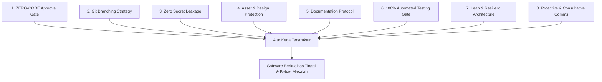
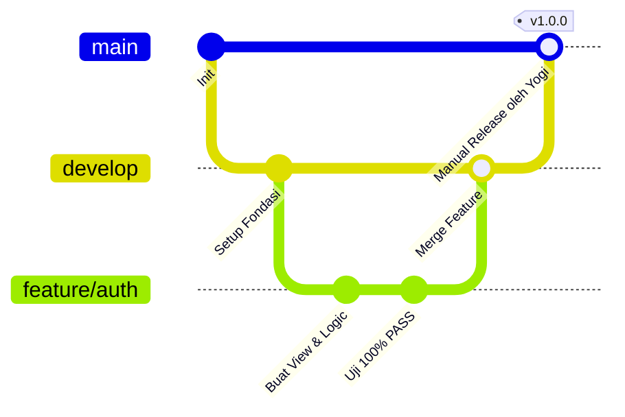

# UNIVERSAL-RULE.md — Kerangka Standar Kerja Pengembangan Proyek & AI Agent

> **STATUS:** DOKUMEN STANDAR UNIVERSAL (MASTER FRAMEWORK)
> **OTORITAS TERTINGGI:** YOGI (PROJECT OWNER / LEAD DEVELOPER)
> **TARGET PENGGUNA:** Seluruh Pengembang (Human Developer) & AI Agent (Antigravity, Gemini, Claude, Cursor, dll.)
> **REUSABILITAS:** Wajib disalin dan diterapkan pada setiap repositori atau proyek baru yang dikelola oleh Yogi.

---

## 📖 Pendahuluan & Filosofi Kerja

Dokumen ini adalah **pedoman tata kelola universal (Universal Governance Framework)** yang dirancang untuk menjaga kualitas, keamanan, transparansi, dan kerapian pengerjaan software engineering dari awal hingga rilis produksi.

Setiap AI Agent atau pengembang yang memulai sesi pada repositori yang mengadopsi dokumen ini **WAJIB membaca, memahami, dan mematuhi 8 Pilar Standar Kerja** berikut tanpa terkecuali.

---

## 🏛️ Delapan Pilar Standar Kerja Universal



---

### 🛑 Pilar 1: ZERO-CODE Sebelum Persetujuan Rencana (Approval Gate)

**Prinsip Inti:** *No Plan, No Code. No Approval, No Code.*

1. **Dilarang Keras Menyentuh Kode Terlebih Dahulu:**
   - Jangan pernah membuat, mengedit, atau menghapus file kode aplikasi sebelum menyusun rencana kerja tertulis dan memperoleh **persetujuan eksplisit** dari Yogi.
2. **Format Wajib Implementation Plan:**
   Setiap kali ada instruksi, fitur baru, atau perbaikan bug, buatlah dokumen rencana (*Implementation Plan*) yang memuat:
   - **Tujuan & Ruang Lingkup:** Apa yang ingin dicapai.
   - **Analisis & Pilihan Solusi:** Tawarkan opsi jika ada trade-off teknis (misal Opsi A vs Opsi B).
   - **Daftar File Target:** File mana yang akan dibuat, dimodifikasi, atau diuji.
   - **Alur Pengujian:** Bagaimana cara membuktikan bahwa fitur bekerja dan bebas regresi.
3. **Gerbang Persetujuan (Approval Gate):**
   - AI Agent wajib berhenti dan menunggu konfirmasi Yogi (misal: pesan "Oke disetujui", "Lanjut", atau respon positif serupa) sebelum menyentuh kode.

---

### 🌿 Pilar 2: Protokol Branching Git & Kontrol Rilis

**Prinsip Inti:** *Branch `main` adalah Mahkota Produksi — Hanya Yogi yang Boleh Me-Merge.*



1. **Branch `main` (Produksi Tertutup):**
   - Berisi kode stabil rilis produksi.
   - **DILARANG KERAS** melakukan commit atau push langsung ke `main` oleh AI Agent atau developer.
   - Merge dari `develop` ke `main` dilakukan **secara manual oleh Yogi**.
2. **Branch `develop` (Branch Integrasi Utama):**
   - Seluruh pembaruan, perbaikan, dan fitur baru yang telah lulus uji wajib digabungkan ke `develop` dan di-push ke `origin develop`.
3. **Branch Fitur (`feature/<nama-fitur>` / `fix/<nama-bug>`):**
   - Setiap pekerjaan mandiri wajib dibuatkan branch tersendiri yang bercabang dari `develop`.
   - Setelah pekerjaan selesai dan lulus uji 100%, branch fitur digabungkan (*merge*) kembali ke `develop`.

---

### 🔐 Pilar 3: Keamanan Kunci Rahasia & Tata Kelola `.env` (Zero Secret Leakage)

**Prinsip Inti:** *Kunci API dan Kredensial Pribadi adalah Aset Paling Sensitif.*

1. **Perlindungan `.gitignore` Sejak Menit Pertama:**
   - File konfigurasi rahasia (`.env`, `.env.local`), file kunci lokal (`Docs/api`, `secrets.json`, file service account), dan database lokal **wajib langsung dimasukkan ke `.gitignore`** sebelum commit perdana.
2. **Larangan Kebocoran Kunci:**
   - Jangan pernah menuliskan nilai kunci API atau token rahasia ke dalam prompt obrolan publik, commit message, atau file kode yang ditrack oleh Git.
3. **Template Konfigurasi Bersih (`.env.example`):**
   - Selalu sediakan dan perbarui file `.env.example` berisi nama variabel tanpa nilai rahasia (gunakan dummy placeholder seperti `your_api_key_here`).

---

### 🎨 Pilar 4: Proteksi Integritas Aset & Desain (`Material/` / Raw Assets)

**Prinsip Inti:** *Aset Asli Tim UI/UX adalah Bahan Rujukan Murni (Read-Only).*

1. **Status READ-ONLY untuk Folder Desain:**
   - Folder prototipe mentah (seperti `Material/`, `design/`, `mockups/`) yang disediakan desainer dilarang keras diubah, ditimpa, atau dihapus oleh AI Agent / Backend Developer.
2. **Pola Adopsi Bersih:**
   - Kode tampilan diadopsi/disalin secara terstruktur ke folder views/components produksi (misal `backend/views/` atau `src/components/`), lalu dihubungkan dengan logic dinamis.

---

### 📝 Pilar 5: Protokol Dokumentasi Wajib (Documentation-First)

**Prinsip Inti:** *Kode Tanpa Dokumentasi adalah Utang Teknis di Masa Depan.*

Setiap repositori wajib memiliki folder `Docs/` dan folder `changelog/` yang selalu diperbarui:


| Nama Berkas                   | Lokasi                              | Fungsi & Aturan Pembaruan                                                                                                                                   |
| ------------------------------- | ------------------------------------- | ------------------------------------------------------------------------------------------------------------------------------------------------------------- |
| **`Task_Status.md`**          | `Docs/Task_Status.md`               | Melacak status seluruh fase proyek, persentase progres, dan checklist tugas real-time.                                                                      |
| **`Decision_Log.md`**         | `Docs/Decision_Log.md`              | Mencatat seluruh keputusan teknis/arsitektur (ID, Tanggal, Topik, Keputusan, Rationale, Status Persetujuan Yogi).                                           |
| **`API_Contract.md`**         | `Docs/API_Contract.md`              | Kontrak spesifikasi endpoint REST API (Method, URL, Header, Request Body, Response HTTP 200/400/500).                                                       |
| **Changelog Bertimestamp**    | `changelog/dd/bb/yyyy/jam/menit.md` | Catatan harian bertimestamp waktu lokal per batch rilis atau tugas selesai.                                                                                 |
| **Panduan Khusus / Tutorial** | `Docs/<nama-modul>.md`              | Tutorial langkah-demi-langkah dari awal sampai akhir untuk setup pihak ketiga (contoh: `Docs/firebase.md`).                                                 |
| **Cadangan Riwayat Chat**     | `Docs/chat/riwayat<ddmmyyyy>.md`    | Arsip komprehensif riwayat dialog interaktif antara Yogi dan AI Agent dari awal hingga akhir sesi (contoh acuan di tiap proyek: `Docs/chat/riwayat16102026.md`). |

---

### 🧪 Pilar 6: Gerbang Verifikasi Pengujian (100% Automated Testing Gate)

**Prinsip Inti:** *Jangan Pernah Bilang Selesai Jika Belum Terbukti Lulus Uji.*

1. **Wajib Memiliki Test Suite Otomatis:**
   - Setiap proyek wajib memiliki skrip verifikasi mandiri (unit test, integration test, atau end-to-end suite) di folder `tests/`.
2. **Definisi Selesai (Definition of Done - DoD):**
   - Suatu tugas hanya boleh dilaporkan selesai jika test suite telah dijalankan di terminal dan menghasilkan:
     **`HASIL: 100% PASS (0 GAGAL / 0 ERROR)`**.
3. **Pencegahan Regresi:**
   - Setiap penambahan fitur baru wajib disertai penambahan kasus uji pada test suite.

---

### ⚡ Pilar 7: Kedisiplinan Arsitektur & Provider (Lean & Resilient)

**Prinsip Inti:** *Sederhana, Cepat, Andal, dan Tanpa Ketergantungan Berlebihan.*

1. **Kunci Provider Tunggal / Efisien (Anti-Bloat):**
   - Hindari mencampuradukkan banyak penyedia layanan pihak ketiga untuk kebutuhan yang sama. Kunci 1 provider terbaik sebagai single source of truth.
2. **Mekanisme Ketahanan (Fallback Multi-Tingkat):**
   - Untuk layanan eksternal kritis (seperti LLM AI atau payment gateway), siapkan sistem fallback otomatis jika terjadi status HTTP 429 (rate limit) atau kegagalan koneksi.
3. **Pemisahan Tanggung Jawab (Separation of Concerns):**
   - Pisahkan urusan Presentasi (Views), Pengontrol Alur (Controllers), Logika Bisnis (Services), Validasi (Validators), dan Penyimpanan Data (Repositories/Models).

---

### 🤝 Pilar 8: Standar Komunikasi & Konsultasi AI Agent

**Prinsip Inti:** *AI Agent adalah Rekan Berpikir (Pair Programmer) yang Ramah, Jelas, dan Edukatif.*

1. **Proaktif Memberikan Solusi Berbasis Opsi:**
   - Jika ada kebingungan atau percabangan teknis, sajikan pilihan (misal: *Opsi A: Cepat & Mandiri* vs *Opsi B: Integrasi Pihak Ketiga*) beserta kelebihan, kekurangan, dan rekomendasi ahli.
2. **Bimbingan Setup Mandiri:**
   - Jika pengguna perlu melakukan konfigurasi manual pada console pihak ketiga (seperti Firebase, GCP, AWS, Meta), AI Agent wajib membuatkan panduan tutorial tertulis lengkap yang jelas dan mudah dipahami.
3. **Gaya Bahasa:**
   - Ramah, profesional, ringkas, dan menggunakan tautan markdown yang dapat diklik (`[file.ext](file:///path/to/file)`).
4. **Kewajiban Menanyakan Pencadangan Riwayat Chat di Akhir Respon:**
   - **Wajib di Setiap Akhir Respon:** Setiap kali selesai memberikan respon (baik merespons pertanyaan, menyajikan rencana, maupun menyelesaikan implementasi), AI Agent **WAJIB secara proaktif bertanya di penutup respon** kepada Yogi apakah ingin mencadangkan (*backup*) riwayat percakapan sesi tersebut.
   - **Pola Penamaan & Lokasi Berkas:** Berkas cadangan disimpan dalam format markdown pada subdirektori terstruktur `Docs/chat/` dengan pola:
     `Docs/chat/riwayat<ddmmyyyy>.md` (contoh rujukan wajib di tiap proyek: `[Docs/chat/riwayat16102026.md](file:///c:/laragon/www/ardenaai/Docs/chat/riwayat16102026.md)`).
   - **Contoh Kalimat Penutup yang Ditanyakan:**
     > *"Apakah Anda ingin saya mencadangkan riwayat percakapan sesi ini ke `Docs/chat/riwayat<ddmmyyyy>.md` (seperti contoh [Docs/chat/riwayat16102026.md](file:///c:/laragon/www/ardenaai/Docs/chat/riwayat16102026.md))?"*
     >
   - **Tujuan Utama:** Menjamin rekam jejak dialog, instruksi pengguna, arsitektur yang dirumuskan, serta keputusan penting terdokumentasi permanen dan tertata rapi dalam folder khusus `Docs/chat/` sehingga tidak tercecer di folder root dokumentasi.

---

## 📁 Struktur Standar Proyek Baru (Starter Template)

Saat menginisialisasi proyek baru bersama Yogi, buatlah struktur direktori standar berikut:

```text
<nama-proyek>/
├── .gitignore                     # Perlindungan awal (.env, secrets, storage logs)
├── .env.example                   # Template konfigurasi tanpa kunci rahasia
├── README.md                      # Dokumentasi pengenalan, arsitektur, dan cara menjalankan
├── AGENTS.md                      # Indeks aturan kerja AI (merujuk ke Docs/universal-rule.md)
├── GEMINI.md                      # Indeks aturan kerja Gemini (merujuk ke Docs/universal-rule.md)
│
├── Docs/                          # Seluruh dokumentasi formal proyek
│   ├── chat/                      # Arsip berkala riwayat percakapan sesi AI
│   │   └── riwayat<ddmmyyyy>.md   # Berkas riwayat chat per tanggal (contoh: Docs/chat/riwayat16102026.md)
│   ├── universal-rule.md          # Dokumen aturan master ini
│   ├── Task_Status.md             # Pelacak progres fase dan checklist tugas
│   ├── Decision_Log.md            # Catatan riwayat keputusan arsitektur
│   ├── API_Contract.md            # Kontrak endpoint & arsitektur data
│   └── Implementation_plan.md     # Rencana induk implementasi proyek
│
├── changelog/                     # Catatan perubahan bertimestamp
│   └── <dd>/<bb>/<yyyy>/<jam>/    # Folder tanggal & jam (misal 15/10/2026/15/)
│       └── <menit>.md             # Berkas log perubahan per sesi
│
├── Material/                      # [READ-ONLY] Aset mentah dari tim UI/UX / Desainer
│
├── src/ atau backend/             # Kode sumber aplikasi utama
│   ├── Controllers/               # Pengontrol alur request
│   ├── Models/                    # Model entitas & struktur data
│   ├── Services/                  # Logika bisnis & integrasi provider
│   ├── Middleware/                # Penjaga keamanan & autentikasi
│   └── views/                     # Template antarmuka pengguna
│
└── tests/                         # Suite pengujian otomatis (wajib 100% PASS)
    └── test_suite.*
```

---

## 📋 Checklist Kepatuhan AI Agent (Pre-Flight Checklist)

Sebelum AI Agent melaporkan suatu tugas selesai kepada Yogi, lakukan verifikasi mandiri menggunakan checklist berikut:

- [ ]  Apakah rencana implementasi telah disetujui Yogi sebelum kode disentuh? (**Pilar 1**)
- [ ]  Apakah branch kerja saat ini adalah `develop` atau `feature/*`, bukan commit langsung ke `main`? (**Pilar 2**)
- [ ]  Apakah seluruh perubahan telah di-push ke `origin develop`? (**Pilar 2**)
- [ ]  Apakah file `.env` dan kunci rahasia lokal terlindungi oleh `.gitignore`? (**Pilar 3**)
- [ ]  Apakah folder aset desain mentah (`Material/`) tetap utuh tanpa modifikasi? (**Pilar 4**)
- [ ]  Apakah `Docs/Task_Status.md` dan `Docs/Decision_Log.md` telah diperbarui? (**Pilar 5**)
- [ ]  Apakah changelog bertimestamp (`changelog/dd/bb/yyyy/jam/menit.md`) sudah dibuat? (**Pilar 5**)
- [ ]  Apakah suite pengujian telah dijalankan dan terbukti **100% PASS**? (**Pilar 6**)
- [ ] Apakah di setiap akhir respon telah bertanya kepada Yogi untuk mencadangkan riwayat chat (`Docs/riwayat<ddmmyyyy>.md`)? (**Pilar 8**)

---

> 💡 **Cara Menggunakan di Proyek Baru:**
> Cukup salin file ini ke dalam folder `Docs/universal-rule.md` di repositori baru Anda, lalu buat file `AGENTS.md` di root proyek yang berisi instruksi:
> *"Seluruh AI Agent wajib membaca dan mematuhi panduan standar kerja di Docs/universal-rule.md sebelum melakukan tindakan apa pun."*
