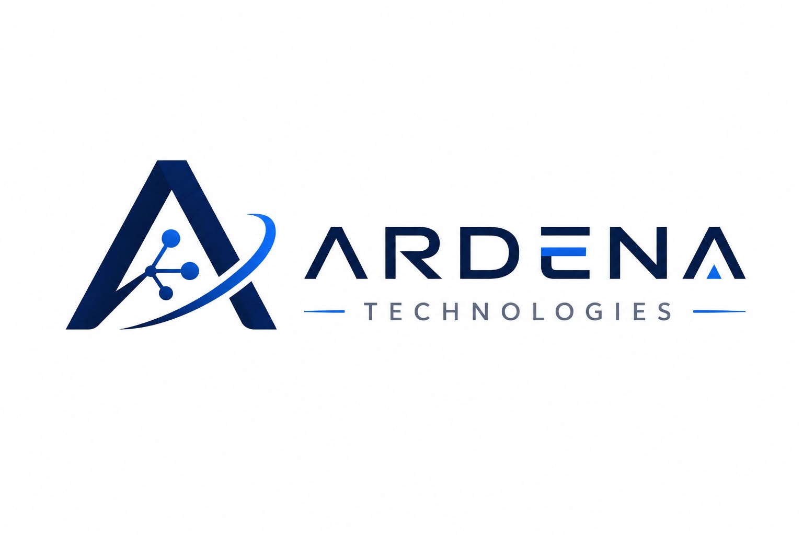

<p align="center">
  
</p>

<h1 align="center">Ardena AI — Scratch 3 Kids Companion Backend</h1>

<p align="center">
  <strong>Asisten AI Cerdas, Ceria, dan Ramah Anak untuk Pembelajaran Pemrograman Visual Scratch 3</strong>
  <br />
  Dibangun dengan <strong>PHP 8.4 Native Modern</strong> &amp; Didukung oleh <strong>Groq LPU Ultra-Fast Engine</strong>.
</p>

<p align="center">
  <!-- Badges -->
  <a href="https://php.net"></a>
  <a href="https://groq.com"></a>
  <a href="https://scratch.mit.edu"></a>
  <a href="https://firebase.google.com"></a>
  
  
</p>

<p align="center">
  
  
  
  
</p>

---

## 📖 Tentang Ardena AI Scratch 3

**Ardena AI Scratch 3** adalah sistem backend komprehensif yang menjembatani antarmuka belajar ramah anak dengan model kecerdasan buatan terdepan. Dirancang khusus bagi siswa Sekolah Dasar (SD usia 7–12 tahun), Ardena memfasilitasi eksplorasi logika coding Scratch melalui percakapan bahasa Indonesia yang menyemangati, transkripsi suara instan, serta pendeteksian foto/tangkapan layar blok Scratch secara multimodal.

---

## ⚡ Fitur-Fitur Utama (Fitur yang Ada)

### 1. 🐱 Asisten Percakapan Logika Scratch 3 (`/api/chat.php`)
- **Model Utama:** `openai/gpt-oss-120b` via Groq LPU (< 1 detik latensi).
- **Mekanisme Auto-Fallback 4 Tingkat:** Menjamin keandalan 100% tanpa putus saat batas kuota (HTTP 429) tercapai:
  1. *Priority 1 (Utama):* `openai/gpt-oss-120b`
  2. *Priority 2 (Cadangan 1):* `qwen/qwen3.8-27b`
  3. *Priority 3 (Cadangan 2):* `openai/gpt-oss-20b`
  4. *Priority 4 (Cadangan 3):* `allam-2-7b`
- **Output JSON Terstruktur & Validasi Blok Scratch:** Otomatis menghasilkan puzzle blok Scratch 3 lengkap dengan warna kategori resmi (*Motion `#4C97FF`*, *Looks `#9966FF`*, *Events `#FFBF00`*, *Control `#FFAB19`*, dsb).

### 2. 🎙️ Input Suara Siswa — Speech-to-Text (`/api/transcribe.php`)
- Mengubah rekaman mikrofon siswa (`.webm`, `.wav`, `.mp3`) langsung menjadi teks pertanyaan menggunakan **Groq Whisper Large v3** (`language=id`).
- Pembersihan berkas audio otomatis seketika setelah transkripsi selesai demi menjaga privasi anak.

### 3. 📷 Analisis Foto Blok Kodingan — Vision Multimodal (`/api/vision.php`)
- Memeriksa foto layar kodingan siswa menggunakan model **Groq Qwen 3.8 27B Multimodal Vision**.
- Mengidentifikasi urutan blok, mendeteksi bug logika kodingan, dan memberikan rekomendasi perbaikan ramah anak.

### 4. 🗄️ Manajemen Riwayat Belajar Siswa (`/api/conversations.php`)
- Integrasi Cloud Firestore dengan pemisahan kepemilikan data berbasis Firebase `uid`.
- Endpoint lengkap untuk melihat daftar riwayat, membuka detail obrolan lama, menyimpan sesi, dan menghapus sesi.

### 5. 🛡️ Keamanan & Privasi Tingkat Tinggi
- Verifikasi kriptografis Firebase ID Token (RS256 JWT Google).
- **Proteksi Secret Mandiri:** Kunci API tersimpan eksklusif di server lokal (`.env`), diabaikan oleh `.gitignore`, dan tidak pernah dikirim ke frontend atau repositori publik.
- **Safe Logging:** Penyensoran otomatis (`***REDACTED***`) untuk seluruh API key, password, dan token.

---

## 🚀 Fitur Masa Depan (Roadmap & Akan Dibuat)

Proyek Ardena AI Scratch 3 dirancang untuk terus berkembang dengan peta jalan fitur berikut:

- [ ] **Interactive Scratch Blocks Canvas Generator:** Rendering canvas interaktif langsung menggunakan library Scratch Blocks / Blockly di sisi frontend browser.
- [ ] **Ekspor Proyek Scratch (`.sb3`):** Fitur unduh berkas proyek siap jalan (`.sb3`) yang langsung dapat dibuka di aplikasi desktop/web Scratch resmi.
- [ ] **Gamifikasi & Modul Tantangan Koding:** Sistem lencana bintang, tantangan mingguan berlevel (pemula, menengah, master game), dan papan skor belajar anak.
- [ ] **Text-to-Speech (TTS) Karakter Ardena:** Suara animasi interaktif yang membacakan penjelasan Ardena dengan intonasi ceria ramah anak.
- [ ] **Dukungan Billing & Sekolah (Multi-Tenant):** Dasbor guru untuk memantau progres belajar logika koding murid dalam satu kelas.

---

## 🏗️ Arsitektur Sistem

```mermaid
graph TD
    subgraph Client_App [Antarmuka Ramah Anak (Frontend)]
        UI_Chat["Workstation Tanya Ardena (chat.html)"]
        UI_Mic["Mikrofon Siswa (MediaRecorder)"]
        UI_Camera["Upload Foto Blok Scratch"]
        UI_History["Riwayat Belajar (riwayat.html)"]
    end

    subgraph Backend_PHP [Backend PHP 8.4 Native]
        Auth["AuthMiddleware (Verify Firebase Token)"]
        ChatAPI["POST /api/chat.php"]
        WhisperAPI["POST /api/transcribe.php"]
        VisionAPI["POST /api/vision.php"]
        HistoryAPI["CRUD /api/conversations.php"]
        BlockValidator["ScratchBlockValidator & AIResponseValidator"]
    end

    subgraph Groq_Cloud [Groq Cloud LPU Engine]
        Groq_Chat["openai/gpt-oss-120b (4x Fallback)"]
        Groq_Whisper["whisper-large-v3 (Audio STT)"]
        Groq_Vision["qwen/qwen3.8-27b (Vision OCR)"]
    end

    subgraph Storage_Cloud [Penyimpanan Data]
        Firestore["Cloud Firestore / Local Storage"]
    end

    UI_Chat -->|Tanya Coding| Auth --> ChatAPI --> Groq_Chat
    Groq_Chat --> BlockValidator --> UI_Chat
    UI_Mic -->|Kirim Rekaman Audio| Auth --> WhisperAPI --> Groq_Whisper
    UI_Camera -->|Kirim Foto Blok| Auth --> VisionAPI --> Groq_Vision
    UI_History -->|Ambil & Simpan Riwayat| Auth --> HistoryAPI --> Firestore
```

---

## 📁 Struktur Direktori Proyek

```text
ardenaai/
├── assets/
│   └── logo.png                      # Logo resmi Ardena AI Scratch 3
├── backend/
│   ├── public/
│   │   ├── index.html                # Entry point aplikasi
│   │   ├── chat.html                 # Antarmuka Workstation Tanya Ardena
│   │   ├── riwayat.html              # Antarmuka Riwayat Obrolan Siswa
│   │   └── api/
│   │       ├── health.php            # GET  - Cek status sistem & Groq
│   │       ├── chat.php              # POST - Chat AI + Fallback 4 tingkat
│   │       ├── transcribe.php        # POST - Speech-to-Text via Whisper
│   │       ├── vision.php            # POST - Analisis foto blok Scratch
│   │       ├── conversations.php     # GET  - Daftar riwayat obrolan
│   │       ├── conversation.php      # GET  - Detail satu obrolan
│   │       ├── conversation-save.php # POST - Simpan obrolan
│   │       └── conversation-delete.php # DELETE - Hapus obrolan
│   ├── src/
│   │   ├── bootstrap.php             # PSR-4 Autoloader & inisialisasi lingkungan
│   │   ├── Config/AppConfig.php      # Parser .env mandiri
│   │   ├── Middleware/               # AuthMiddleware (JWT) & CorsMiddleware
│   │   ├── Services/                 # GroqService, WhisperService, VisionService
│   │   ├── Repositories/             # FirestoreRepository
│   │   ├── Validators/               # ScratchBlockValidator & AIResponseValidator
│   │   └── Support/                  # ApiResponse, Logger, HttpClient
│   ├── storage/                      # Cache lokal, temporary uploads & logs
│   ├── tests/                        # Skrip pengujian otomatis (18/18 PASS)
│   ├── .env.example                  # Template variabel lingkungan
│   └── README.md                     # Dokumentasi teknis backend
├── Docs/
│   ├── Implementation_plan.md       # Master acuan kerja versi tetap
│   ├── Audit_Report.md              # Laporan audit lingkungan & sistem
│   ├── API_Contract.md              # Spesifikasi lengkap kontrak API
│   ├── Decision_Log.md              # Catatan seluruh keputusan arsitektural
│   ├── Task_Status.md               # Pelacakan status tugas per fase
│   └── Test_Report.md               # Laporan hasil pengujian komprehensif
├── Material/                        # Template UI asli tim Frontend (dipertahankan)
├── changelog/                       # Catatan riwayat bertimestamp (dd/bb/yyyy/jam/menit.md)
├── .gitignore                       # Proteksi kunci API dan berkas rahasia
├── AGENTS.md                        # Aturan standar pengerjaan untuk AI Agent / sesi baru
└── README.md                        # Dokumentasi utama proyek
```

---

## 🛠️ Panduan Menjalankan Secara Lokal

### 1. Prasyarat Lingkungan
- **PHP 8.2+** (Direkomendasikan **PHP 8.4**) dengan ekstensi: `curl`, `json`, `openssl`, `mbstring`, `fileinfo`, `gd`.
- Web Server: **Laragon** (Windows) atau PHP Built-in Server.

### 2. Setup Konfigurasi
1. Salin template environment:
   ```bash
   cp backend/.env.example backend/.env
   ```
2. Pastikan file `backend/.env` memuat kunci Groq API Anda:
   ```ini
   GROQ_API_KEY=gsk_your_groq_api_key_here
   ```

### 3. Eksekusi Pengujian Otomatis
Jalankan seluruh test suite untuk memastikan seluruh endpoint dan integrasi AI berfungsi 100%:
```bash
php backend/tests/test_full_suite.php
```
*Hasil yang diharapkan: `HASIL: 18 LULUS, 0 GAGAL (100% PASS)`.*

### 4. Menjalankan Aplikasi
- **Melalui Laragon:**
  Cukup buka browser di alamat:
  `http://localhost/ardenaai/backend/public/chat.html`
- **Melalui PHP Built-in Server:**
  ```bash
  php -S localhost:8000 -t backend/public
  ```
  Buka browser di `http://localhost:8000/chat.html`.

---

## 📜 Kepatuhan Standar Kerja untuk Pengembang & AI

Proyek ini menerapkan protokol kerja bertahap yang sangat ketat:
- Setiap developer atau AI Agent yang melanjutkan pekerjaan proyek ini **wajib membaca dan mematuhi [AGENTS.md](AGENTS.md)**.
- **Dilarang menulis kode tanpa persetujuan rencana implementasi terlebih dahulu.**
- Seluruh riwayat perubahan wajib dicatat ke dalam folder berformat `changelog/dd/bb/yyyy/jam/menit.md`.

---

<p align="center">
  Dibuat dengan ❤️ untuk generasi programmer cilik Indonesia 🇮🇩 • <strong>Ardena AI Team</strong>
</p>
